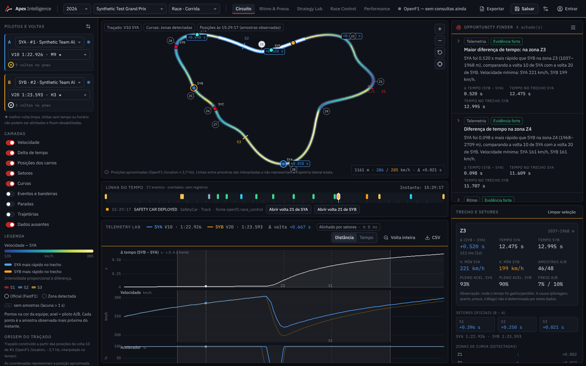
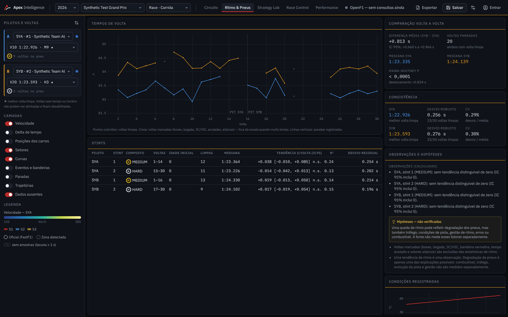
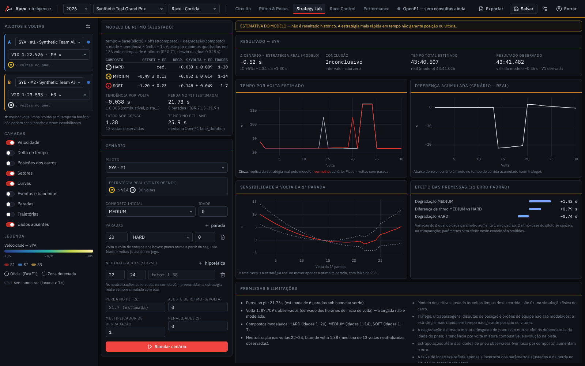
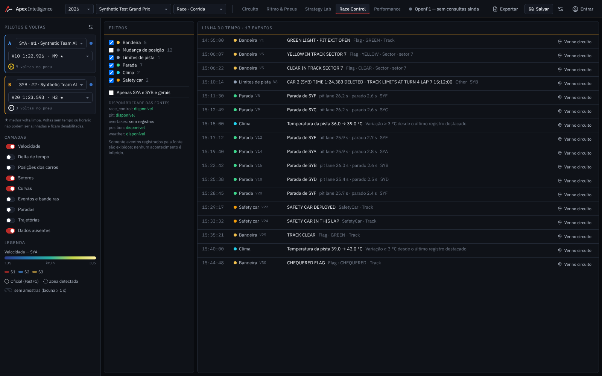

# Apex Intelligence

Laboratório digital de corrida de Fórmula 1: conecta o que aconteceu na pista, o que dá para investigar e o que poderia ter acontecido.

## Para quem é
Fãs, analistas e criadores de conteúdo que querem entender corridas de Fórmula 1 a fundo, com dados reais.

## O que faz
- **Circuito e telemetria**: mapa interativo do circuito sincronizado com os gráficos de telemetria e a linha do tempo da corrida.
- **Opportunity Finder**: encontra automaticamente trechos e momentos onde houve diferença relevante entre pilotos.
- **Ritmo e pneus**: tempos por volta, stints, compostos, degradação e clima.
- **Strategy Lab**: simula estratégias alternativas (paradas, compostos, safety car, penalidades).
- **Race Control**: bandeiras, safety car, mensagens oficiais, paradas e ultrapassagens; cada evento leva ao instante exato no circuito.
- **Análises salvas e relatórios** para exportar.
- Nenhum dado é inventado: ausência de dado aparece como ausência.

## Telas

---

Este repositório é uma **vitrine** do projeto: mostra o que o sistema faz e como ele é. O código-fonte não é público.

Desenvolvido por [@won3er](https://github.com/won3er).